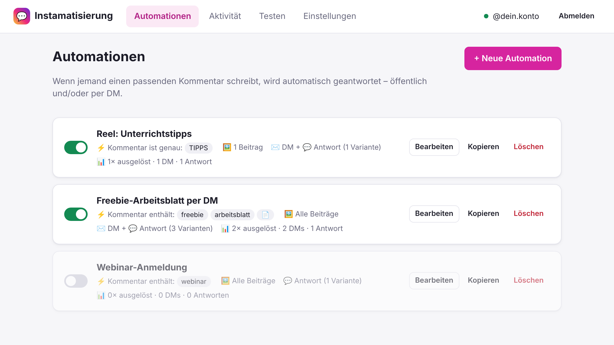
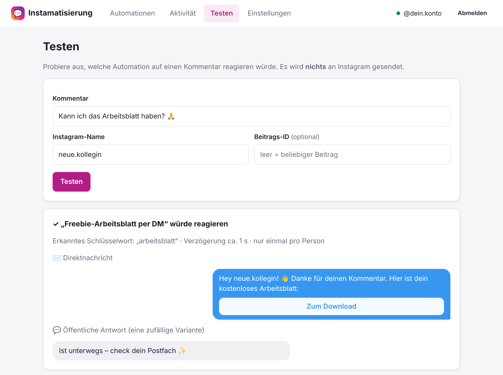
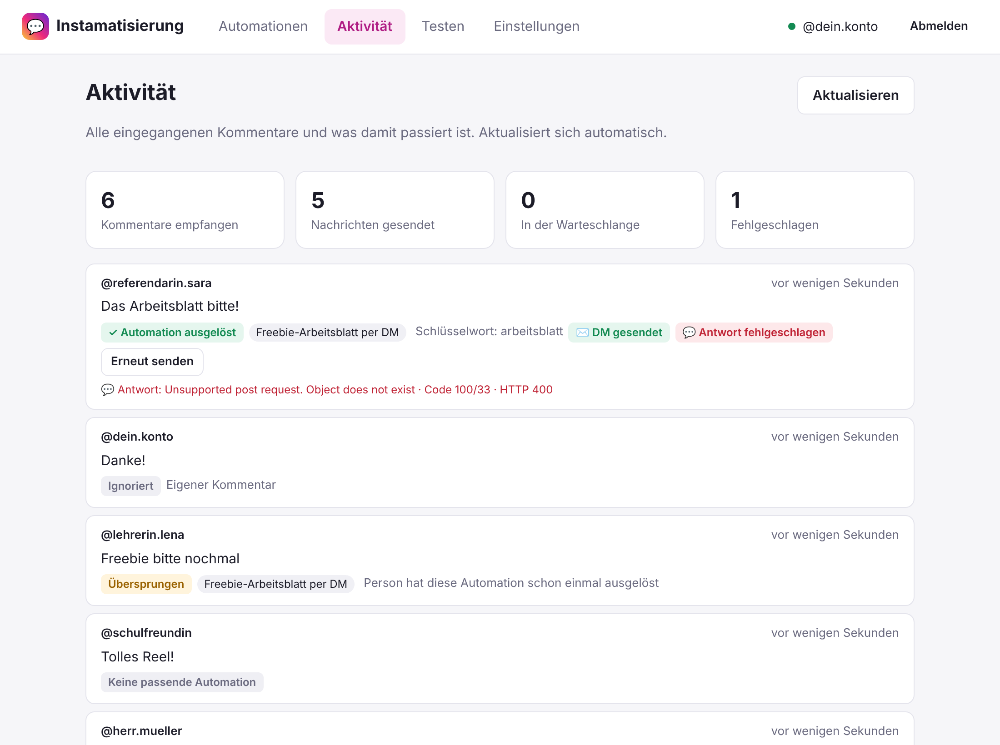

# 💬 Instamatisierung

**Automatische Antworten auf Instagram-Kommentare**, ähnlich wie ManyChat, aber selbst gehostet und ohne monatliche Gebühren.

Jemand kommentiert „Info“ unter deinem Reel → das Tool schickt automatisch eine **Direktnachricht** (z. B. mit Link zu deinem Freebie) und antwortet **öffentlich** unter dem Kommentar („Schau in deine DMs 📩“).

> 🆓 **Nur für dein eigenes Konto und kostenlos?** Dann folge der Schritt-für-Schritt-Anleitung **[ANLEITUNG.md](ANLEITUNG.md)**. Das Tool läuft dabei auf deinem Computer, ohne Server und ohne App-Prüfung.



## Was das Tool kann

- **Schlüsselwort-Auslöser**: „enthält Wort“ (z. B. `info` passt zu „Info bitte! 😍“, aber nicht zu „Informationen“), „ist genau“ oder „jeder Kommentar“. Groß-/Kleinschreibung egal, Emojis gehen auch (`🔥`).
- **Für alle Beiträge oder nur für bestimmte**: Beiträge und Reels lassen sich per Klick aus deinem Profil auswählen.
- **Direktnachricht (Private Reply)**: mit optionalem Link-Button.
- **Öffentliche Antwort** mit mehreren Varianten, von denen zufällig eine gewählt wird. Das wirkt natürlicher.
- **Platzhalter**: `{username}` und `{kommentar}`.
- **Jede Person nur einmal** pro Automation beantworten (abschaltbar).
- **Verzögerung mit Zufall**, damit es nicht nach Bot aussieht.
- **Aktivitätsprotokoll**: Jeder Kommentar wird angezeigt, dazu, was gesendet wurde und was fehlgeschlagen ist (mit „Erneut senden“).
- **Testmodus**: Du kannst ausprobieren, welche Automation reagieren würde, ohne dass etwas gesendet wird.
- **Robust**: Warteschlange in der Datenbank (übersteht Neustarts), automatische Wiederholung bei Rate-Limits, doppelte Webhooks werden erkannt, eigene Kommentare werden ignoriert.
- **Token-Verlängerung**: Der Instagram-Token (60 Tage gültig) wird wöchentlich automatisch erneuert.
- **Zwei Empfangswege**: Webhooks (sofort) und/oder ein **Abfrage-Modus**, der neue Kommentare regelmäßig selbst abholt.
- **Sicher**: Webhook-Signaturprüfung, passwortgeschütztes Dashboard, keine externen Skripte.

| Testen | Aktivität |
| --- | --- |
|  |  |

---

## ⚠️ Wichtig vorab: Was Instagram erlaubt

Diese Regeln kommen von Instagram/Meta und gelten für **jedes** Tool, auch für ManyChat:

1. Du brauchst ein **Business- oder Creator-Konto** (kein privates Konto), und es muss **öffentlich** sein.
2. Pro Kommentar ist **genau eine private Antwort (DM)** möglich, und zwar **innerhalb von 7 Tagen**. Weitere Nachrichten darfst du erst schicken, wenn die Person zurückschreibt (danach gilt ein 24-Stunden-Fenster).
3. **Die Meta-App muss geprüft werden**, bevor das Tool für fremde Kommentare voll funktioniert:
   - **Kommentar-Webhooks** verschickt Meta nur, wenn die App auf **„Live“** steht und für `instagram_business_manage_comments` **Advanced Access** hat. Dafür braucht es die **App-Prüfung (App Review)** und die **Unternehmensverifizierung (Business Verification)**.
   - Für **DMs an beliebige Personen** gilt dasselbe für `instagram_business_manage_messages`.
   - Im Entwicklungsmodus funktioniert alles nur mit Konten, die eine Rolle in deiner App haben (z. B. Tester). Damit kannst du gut testen.
4. **Bis die App-Prüfung durch ist:** Schalte den **Abfrage-Modus** ein (`POLL_INTERVAL_SECONDS=60`). Dann holt das Tool neue Kommentare selbst ab, statt auf Webhooks zu warten. Später kannst du ihn als Absicherung anlassen.

---

## 🚀 Schnellstart (lokal ausprobieren)

Voraussetzung: [Node.js](https://nodejs.org) **Version 22.13 oder neuer**.

```bash
git clone <dieses-repository>
cd Instamatisierung
npm install
npm run setup     # Assistent: Dashboard-Passwort + Modus wählen, schreibt die Datei .env
npm start
```

Alternativ `.env.example` nach `.env` kopieren und von Hand ausfüllen.

Öffne <http://localhost:3000> und melde dich mit deinem `ADMIN_PASSWORD` an. Du kannst sofort Automationen anlegen und im Reiter **Testen** ausprobieren.

Damit Instagram deinen Server erreicht, muss er **öffentlich per https** erreichbar sein (siehe [Hosting](#-hosting)). Für lokale Tests eignet sich ein Tunnel wie `ngrok http 3000` oder `cloudflared tunnel --url http://localhost:3000`.

---

## 🛠️ Einrichtung Schritt für Schritt

### 1. Instagram-Konto vorbereiten

In der Instagram-App: *Einstellungen → Kontotyp und Tools → Zu professionellem Konto wechseln* (Business oder Creator). Unter *Einstellungen → Nachrichten* sollte „Zugriff auf Nachrichten erlauben“ (für verbundene Tools) aktiviert sein.

### 2. Meta-App anlegen

1. Auf <https://developers.facebook.com/apps> **App erstellen** klicken.
2. Als Anwendungsfall **„Nachrichten und Inhalte auf Instagram verwalten“** wählen (bzw. App-Typ **Business** und dann das Produkt **Instagram** hinzufügen).
3. Links im Menü: **Instagram → API-Einrichtung mit Instagram-Login**.
4. Oben auf der Seite stehen **Instagram-App-ID** und **Instagram-App-Geheimschlüssel**. Den Geheimschlüssel brauchst du als `IG_APP_SECRET`.

### 3. Server online stellen

Siehe [Hosting](#-hosting). Setze mindestens diese Umgebungsvariablen:

| Variable | Wert |
| --- | --- |
| `ADMIN_PASSWORD` | dein Dashboard-Passwort |
| `IG_APP_SECRET` | Instagram-App-Geheimschlüssel aus Schritt 2 |
| `IG_VERIFY_TOKEN` | ein beliebiges selbst ausgedachtes Wort, z. B. `mein-geheimes-verify-wort` |

### 4. Instagram-Konto verbinden

1. Im Meta-Portal unter **API-Einrichtung mit Instagram-Login → 1. Zugriffsschlüssel generieren** dein Instagram-Konto hinzufügen und **Token generieren** klicken.
2. Im Dashboard unter **Einstellungen → Access Token eintragen** den Token einfügen und **Speichern & prüfen** klicken. Oben rechts erscheint dann `@deinkonto`.

### 5. Webhook einrichten

1. Im Dashboard unter **Einstellungen** die **Rückruf-URL** kopieren (z. B. `https://dein-server.de/webhook`).
2. Im Meta-Portal unter **2. Webhooks konfigurieren**:
   - Rückruf-URL: die kopierte URL
   - Überprüfungstoken: der Wert von `IG_VERIFY_TOKEN`
   - **Überprüfen und speichern** klicken
   - Beim Feld **`comments`** auf **Abonnieren** klicken
3. Im Dashboard unter **Einstellungen** auf **Kommentar-Webhooks abonnieren** klicken.

### 6. Erste Automation anlegen

Reiter **Automationen → + Neue Automation**, zum Beispiel:

- **Name**: Freebie per DM
- **Auslöser**: Kommentar enthält `freebie, guide, info`
- **DM**: „Hey {username}! 👋 Hier ist dein kostenloser Guide:“ + Button „Zum Guide“ → `https://…`
- **Öffentliche Antwort** (eine pro Zeile):
  ```
  Schau in deine DMs, @{username}! 📩
  Ist unterwegs, check dein Postfach ✨
  Hab dir was geschickt 💌
  ```

Unter **Testen** prüfen, ob alles passt. Fertig! 🎉

### 7. App-Prüfung für den Live-Betrieb

Damit das Tool auf Kommentare **aller** Personen reagiert:

1. **Unternehmensverifizierung** im Meta Business-Portfolio abschließen.
2. In der App unter **App-Prüfung → Berechtigungen und Funktionen** Advanced Access beantragen für:
   - `instagram_business_basic`
   - `instagram_business_manage_comments`
   - `instagram_business_manage_messages`
3. Meta verlangt dafür eine Datenschutzerklärung (URL) und ein kurzes **Bildschirmvideo**, das zeigt, wie die App die Berechtigungen nutzt. Zeig darin das Dashboard: eine Automation anlegen, einen Testkommentar schreiben, Antwort und DM erscheinen.
4. Nach der Freigabe die App oben auf **Live** schalten.

---

## ☁️ Hosting

Der Server muss **dauerhaft laufen** (keine Gratis-Tarife, die „einschlafen“) und die Datenbank auf einem **dauerhaften Speicher** ablegen.

### Mit Docker (z. B. auf einem eigenen VPS)

```bash
docker build -t instamatisierung .
docker run -d --name instamatisierung --restart unless-stopped \
  -p 3000:3000 -v instamatisierung-data:/data --env-file .env \
  instamatisierung
```

Davor gehört ein Reverse-Proxy mit https (z. B. [Caddy](https://caddyserver.com): `dein-server.de { reverse_proxy localhost:3000 }`).

### Mit einer Plattform (Render, Railway, Fly.io, …)

- Repository verbinden. Das `Dockerfile` wird automatisch erkannt, alternativ Startbefehl `npm start`.
- Umgebungsvariablen eintragen (siehe oben).
- Ein **Volume / Persistent Disk** anlegen und `DATABASE_PATH` darauf zeigen lassen (beim Docker-Image standardmäßig `/data/instamatisierung.db`, also das Volume unter `/data` einhängen).
- Es läuft genau **eine** Instanz (SQLite + interne Warteschlange).

---

## ⚙️ Alle Einstellungen

| Variable | Standard | Bedeutung |
| --- | --- | --- |
| `PORT` | `3000` | Port des Servers |
| `ADMIN_PASSWORD` | – | **Pflicht.** Passwort fürs Dashboard |
| `SESSION_SECRET` | automatisch | Optional. Mind. 16 Zeichen, signiert die Login-Sitzung. Fehlt es, wird eines erzeugt und gespeichert |
| `IG_APP_SECRET` | – | Instagram-App-Geheimschlüssel (für Webhook-Signaturen). Mehrere mit Komma möglich |
| `IG_VERIFY_TOKEN` | – | Selbst gewähltes Wort für die Webhook-Bestätigung |
| `IG_ACCESS_TOKEN` | – | Optional, Token kann auch im Dashboard eingetragen werden |
| `IG_GRAPH_VERSION` | `v25.0` | Version der Graph API |
| `POLL_INTERVAL_SECONDS` | `0` (aus) | Abfrage-Modus: alle X Sekunden nach neuen Kommentaren schauen (mind. 30) |
| `POLL_MEDIA_COUNT` | `5` | Abfrage-Modus: Anzahl der neuesten Beiträge, die geprüft werden (+ alle in Automationen ausgewählten) |
| `DATABASE_PATH` | `./data/instamatisierung.db` | Speicherort der SQLite-Datenbank |
| `MIN_SECONDS_BETWEEN_API_CALLS` | `2` | Mindestabstand zwischen API-Aufrufen |
| `MAX_ATTEMPTS` | `3` | Versuche bei temporären Fehlern (Rate-Limit, Störung) |
| `TRUST_PROXY` | `loopback, linklocal, uniquelocal` | Für Express: welchen Proxys vertraut wird |

---

## 💡 Tipps

- **Reihenfolge**: Automationen für *bestimmte Beiträge* werden vor allgemeinen geprüft, danach entscheidet die **Priorität** (kleinere Zahl zuerst). Es reagiert immer nur **eine** Automation pro Kommentar.
- **„Jeder Kommentar“** am besten nur für einzelne Beiträge verwenden, sonst bekommt jede Person eine DM.
- **Mehrere Antwort-Varianten** verwenden. Instagram mag es nicht, wenn hundertmal derselbe Text gepostet wird.
- Eine kleine **Verzögerung** (10–30 s) wirkt natürlicher als eine Antwort in der gleichen Sekunde.
- Die DM wird zuerst geschickt, die öffentliche Antwort ein paar Sekunden später. So steht die Nachricht schon im Postfach, wenn „Schau in deine DMs“ erscheint.
- Falls Instagram den **Button** in der privaten Antwort ablehnt, schickt das Tool automatisch den Text mit dem Link darunter.

---

## ❓ Fehlerbehebung

| Problem | Lösung |
| --- | --- |
| Webhook lässt sich im Meta-Portal nicht speichern | Server muss per **https** öffentlich erreichbar sein; `IG_VERIFY_TOKEN` muss exakt übereinstimmen. |
| Im Server-Log steht „Webhook mit ungültiger Signatur abgelehnt“ | Falscher Geheimschlüssel. Zusätzlich den Meta-App-Geheimschlüssel (*Einstellungen → Allgemeines*) mit Komma angeben: `IG_APP_SECRET=insta_secret,meta_secret`. |
| Es kommen keine Kommentare an | App ist nicht **Live** bzw. hat keinen **Advanced Access** für Kommentare (siehe oben). Bis dahin den Abfrage-Modus nutzen. Außerdem in den Einstellungen „Kommentar-Webhooks abonnieren“ klicken. Das Konto muss öffentlich sein. |
| DM schlägt fehl | Pro Kommentar geht nur eine private Antwort, max. 7 Tage alt. Im Entwicklungsmodus nur an Tester. Die Fehlermeldung von Instagram steht im Reiter **Aktivität**. |
| „Invalid OAuth access token“ | Token abgelaufen oder ungültig → neuen Token im Dashboard eintragen. Danach fehlgeschlagene Aktionen mit „Erneut senden“ nachholen. |

---

## 🧑‍💻 Für Entwickler:innen

```bash
npm test        # Tests (node:test, keine weiteren Abhängigkeiten)
npm run dev     # Server mit automatischem Neustart
```

Aufbau:

```
src/
  server.js      Express-Server: Webhook, Dashboard-API, Start
  webhook.js     Signaturprüfung + Auslesen der Webhook-Daten
  automation.js  Kommentar verarbeiten → passende Automation → Aktionen einplanen
  matcher.js     Schlüsselwort-Logik, Platzhalter, Validierung
  worker.js      Warteschlange: DMs/Antworten senden, Wiederholungen, Abstand
  poller.js      Abfrage-Modus (Kommentare selbst abholen)
  instagram.js   Client für die Instagram Graph API
  account.js     Access Token speichern/verlängern
  auth.js        Login-Sitzung fürs Dashboard
  db.js          SQLite (eingebaut in Node, node:sqlite)
scripts/setup.js Einrichtungs-Assistent (npm run setup)
public/          Dashboard (HTML/CSS/JS ohne Build-Schritt)
test/            Tests
```

Genutzte Instagram-Endpunkte (Instagram API mit Instagram-Login, `graph.instagram.com`):

- `POST /{comment-id}/replies` – öffentliche Antwort
- `POST /me/messages` mit `recipient.comment_id` – private Antwort (DM)
- `GET /me`, `GET /me/media`, `GET /{media-id}/comments`
- `POST /me/subscribed_apps?subscribed_fields=comments` – Webhooks abonnieren
- `GET /refresh_access_token` – Token verlängern
